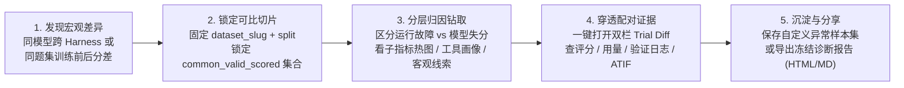

# 02-5 · 深度结果诊断与客观轨迹证据中心

> **关联元数据**
> - **真实数据源**：SQLite `episodes`（含 `failure_kind`, `verifier_rewards_json`, `input/cached/output/reasoning_tokens`, `duration_sec`, `tool_call_count`）+ ATIF `trajectory.json` 与 `model-gateway.json` 客观统计缓存（`trial_observable_clues`）
> - **核心 API**：`GET /api/v1/diagnostics/failures`、`GET /api/v1/diagnostics/submetrics`、`GET /api/v1/diagnostics/efficiency`、`GET /api/v1/diagnostics/tools`、`GET /api/v1/diagnostics/clues`
> - **权限要求**：聚合诊断图表 `Viewer+`；点击异常点下钻到 Trial 轨迹/网关正文/验证日志按 6 项明细 Scope 校验
> - **数据诚实边界**：**彻底删除无分类器支撑的「安全拒答率」「Reward Hacking 判定」「提前摆烂判定」等主观/定性标签**；所有轨迹分析严格限定为实际记录了工具事件的 Harness，并在每张卡顶部显式标注可观测样本覆盖率（如 `334/352 含工具记录的 Harbor Trial`）
> - **交付里程碑**：**M2（全量交付）**

---

## 0. 本页三层信息层级与状态恢复契约

| 披露层 | 用户看到什么 | 交互入口 | 返回后恢复哪些状态 |
|---|---|---|---|
| **默认展示 (L0)** | 顶部「运行故障 vs 有效 0 分 vs 未评分」分布条 + 当前诊断 Tab 核心聚类/热力图/帕累托/工具画像与客观线索覆盖率 | 切换 5 个诊断 Tab、筛选 Harness/Runner/Dataset/时间窗 | 筛选条件与激活 Tab 双向同步 URL Query |
| **点击展开 (L1/L2)** | 悬停色块/热力格/散点看精确分母与样本占比；点击任意故障聚类、失分子指标格或线索卡片，在下方或右侧抽屉立即展开命中 Trial 列表与固定中文摘要 | 勾选命中 Trial 保存为自定义异常样本集，或一键带入 `/eval/compare` | 关闭抽屉原位保留当前诊断切片、图表缩放与激活 Tab |
| **完整证据 (L3)** | 点击任一命中 Trial 或双栏对比入口进入 L3 显微镜，按权限查看折叠/分页的 ATIF 配对工具卡、网关 `discarded` 轮次或验证器原始日志 | 面包屑或「返回诊断切片」 | 无损恢复原诊断 Tab、过滤条件与选中聚类焦点 |

---

## 1. 研究员端到端 5 步“异常定位 → 证据闭环”工作流

- 视图顶部始终固定**「运行故障 vs 有效 0 分 vs 未评分」分布条**、当前样本量与可比性状态标签，防止把网关超时或 `vlmevalkit` 纯推理未打分误判为模型能力下降。

---

## 2. 5 大专项诊断面板（Tab 布局 `/eval/diagnostics`）

### 2.1 故障根因聚类（Failure Taxonomy）
- 按 `batch_guard.py` 真实定义的 14 类故障签名（`agent_tls`、`agent_protocol`、`agent_cli`、`agent_auth`、`agent_rate_limit`、`agent_connect`、`agent_install`、`agent_exit`、`agent_timeout`、`agent_setup_timeout`、`environment_timeout`、`environment_error`、`verifier_timeout`、`verifier_error`、`cancelled`、`run_error`）以及 `vlmevalkit` 异常类型（如 `VLMEvalKitInferenceError`、`VLMEvalKitPromptError`）生成堆叠柱状图与 Treemap。
- 支持按 `Harness`、`Runner`、`Dataset`、脱敏主机、时间窗交叉透视；点击任意色块下方列出对应失败 Trial 清单（带固定中文摘要、`http_status` 与脱敏日志定位）。

### 2.2 多维 Verifier 与学科子指标热力图（Sub-Metric Matrix）
- 自动识别含多个命名子指标的真实产物：
  - **WildClawBench 17 项 `verifier_rewards` 约束**（`output_files_valid`、`no_attendee_conflicts`、`attendee_unavailability_respected`、`hard_constraint_pass`、`optimality_ratio` 等）；
  - **DeepSWE** `f2p_passed/total`、`p2p_passed/total`、`apply_failed`；
  - **VLMEvalKit `vlmevalkit/metrics.json`** 学科分项（如 CMMMU 6 大学科、MMMU-Pro 学科拆分、AI2D `partsOfA`）。
- 生成 `Model × Harness × Sub-Metric` 与 `Task × Sub-Metric` 热力矩阵（色阶 0% 红 → 100% 绿），点击任一格子直达对应失分 Trial 或批次。

### 2.3 效率与帕累托归因（Duration & Token Frontier）
- 散点图默认仅使用 100% 真实已有维度：X 轴可选 `总耗时 (duration_sec)` / `Agent 执行耗时 (agent_exec_s)` / `总 Tokens` / `Reasoning Tokens`（兼容 `reasoning_tokens` 与 `reasoning_output_tokens`），Y 轴为得分，气泡大小为工具步数（若有）。
- **Token 构成诊断视图**：严格执行包含语义校验（见 `03-2 §3.3`）：仅对已验证 `cached ⊆ input` 且 `reasoning ⊆ output` 的来源绘制互斥 4 段堆叠条；未验证来源并排展示各字段数值并标注数据覆盖率（如 197 实测 336 份 Harbor ATIF 中 329 份含 `reasoning_tokens`、3 份含 `reasoning_output_tokens`、9 份含 `total_cached_tokens`）。
- 可选成本轴仅在原生存在 `cost_usd` 时标注「已记录成本（有账单对账再标实付）」，价目表估算明确标记「估算」。**严禁以总时长冒充逐请求 TTFT / TPS。**

### 2.4 Tool Call 工具生态画像（严格限定有工具记录的 Harness）
- **覆盖范围守门条**：面板顶部强制展示本次筛选中「实际记录工具事件的 Trial 占比」（例如 `334 / 352 Harbor ATIF 含工具调用；OpenClaw 2026.11.5、VLMEvalKit、Direct 未记录 ATIF 工具事件，已自动排除不拉低统计`）。
- 基于 ATIF `trajectory.json` 客观字段 `steps[].tool_calls[].function_name` 与配对 `observation.results[].is_error` 聚合：
  - 按 Harness / Model 拆解工具调用频次排行（`bash`、`read`、`edit`、`write`、`grep` 等）；
  - 各工具 `is_error == true` 报错率排行；
  - **有效通过 vs 有效 0 分样本对比分布**：步数箱线图、工具调用次数直方图、最大单轮 Prompt Token 分布曲线。

### 2.5 ATIF / 网关客观轨迹线索统计（仅呈现可观测证据与覆盖率，不做行为定性）
索引器扫描 ATIF `trajectory.json` 与 `model-gateway.json` 时，仅计算以下 **4 项 100% 客观可统计、可复现的原始轨迹线索**（绝不输出“作弊/摆烂”等无分类器支撑的定性结论）：

| 线索代码 | 精确客观统计定义（阈値可配） | 适用数据源与覆盖分母 | 用途（仅供人工复核线索） |
|---|---|---|---|
| `repeated_identical_tool_call` | 连续 ≥ 3 步 `tool_calls` 出现相同 `function_name` 且参数规范化哈希一致 | 含 ATIF 工具记录的 Harbor Trial（标注 `N/M` 覆盖） | 快速筛选疑似重复调用同一命令的 Trial 进入人工检查 |
| `consecutive_tool_errors` | 连续 ≥ 4 次工具配对观察返回 `is_error == true` | 含 ATIF 工具记录的 Harbor Trial | 定位连续命令报错或环境缺依赖样本 |
| `gateway_discarded_or_msg_drop` | `model-gateway.json` 出现 `discarded == true` 轮次，或相邻轮次 `len(request_messages)` 下降 > 30% | 含 `model-gateway.json` 的批次（标注覆盖数，当前 197 有 6 份） | 观测真实发生上下文压缩或回退分支的轮次 |
| `step_or_token_outlier` | 有效 0 分且单次 Trial 步数或总 Token 高于同批 P95（或自定义阈值） | 有步数或 Token 记录的 Trial | 定位高消耗但未得分样本，直开轨迹核查原因 |

- 每项线索卡片必须同屏展示：**精确规则公式 + 适用覆盖分母 + 命中 Trial 数 + 一键打开原始轨迹证据列表**（可保存为自定义样本集供人工复审）。
