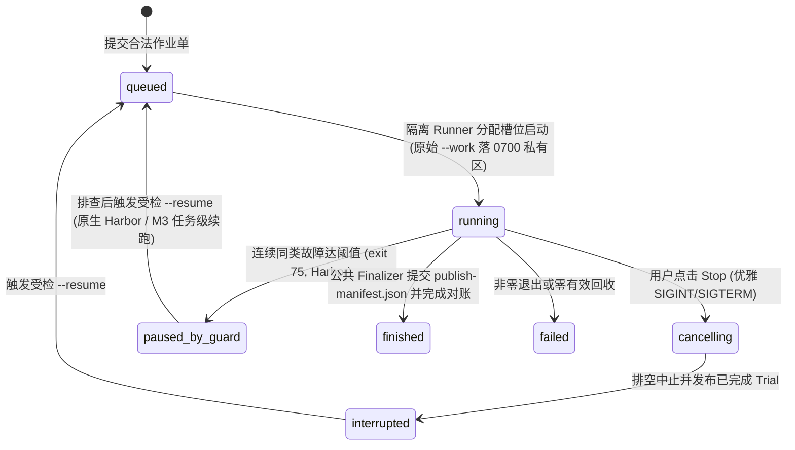

# 02-6 · 受控评测执行监控（三运行器实时流）与 Direct 原生验证工作台

> **现行执行**见 [开发要求与上线状态](../CURRENT.md#已上线)，含题库优先和登录成员权限。[执行页分段加载](../CURRENT.md#已确认待发布或验收)仍待验收。

> **关联元数据**
> - **真实数据源**：`/home/share-data/tianxi_benches/framework/{run.py, harbor.toml, direct.py, vlmevalkit.py, batch_guard.py, report.py, DATASET_FORMAT.md, VLMEVALKIT.md}` + 服务端受保护 `gateways.env`（本地 ext4 `0600`）+ Runner 实时 NDJSON 事件流 + SQLite `exec_jobs` / `exec_job_events` / `direct_lab_runs`
> - **核心 API**：`GET /api/v1/execution/capabilities`、`POST /api/v1/execution/plan`、`POST /api/v1/execution/jobs`、`GET /api/v1/execution/jobs/{id}/stream` (SSE + `Last-Event-ID`)、`POST .../resume`、`POST .../cancel`、`GET/POST /api/v1/direct-lab/*`
> - **权限要求**：查看执行历史 `Viewer+`（受 `project_id` 边界控制）；`--plan` 预检、提交执行、Direct 验证台调网关均需 **`Researcher+` + CSRF + 服务端 Gateway Profile 授权**
> - **交付里程碑**：Execution 配置/CLI生成/`--plan`/历史监控在 **M1** 可用；Direct 验证工作台在 **M2** 交付（严格对齐 `direct.py:33-37` 原生契约）；隔离 Runner 在线触发与实时事件流在 **M3** 交付

---

## 1. Benchmark Execution 评测执行与监控（`/eval/execution`，对齐 `run.py` 真实语义）

### 1.1 四条运行链路的真实源码约束与状态机

经 197 源码核验（`run.py`、`direct.py`、`vlmevalkit.py`、`VLMEVALKIT.md`）：
1. **无原生手动暂停**：`paused_by_guard`（退出码 `75`）仅由 `batch_guard:DispatchGuard` 连续故障熔断触发；运行中仅提供 `Stop (优雅中止)`。
2. **仅公共 Finalizer 提交共享快照**：运行中可能先写 `batch-status.json`（`status="running"`），结束并由公共 Finalizer 写完所有文件与 `publish-manifest.json`（含 `generation_id`）后才产生完整快照；实时逐题进度依赖 M3 隔离 Runner 的 SSE 事件流。
3. **四条链路的执行环境、评分模式与续跑边界**：
   - **Harbor 标准模式**：隔离容器 Runner；支持原生 `--resume`（需锁定 `harness_version` 且私有 `--work` 锁完整）；
   - **Harbor Gateway 模式（`--gateway-capture`）**：隔离容器 Runner + OpenEnv 代理；**原生不支持 `--resume`**；
   - **Direct 模式（`runner="direct"`）**：仅需 Python + 网关，无需 Docker；**原生不支持 `--resume`**；
   - **VLMEvalKit 模式（`runner="vlmevalkit"`）**：仅需 `VLMEVALKIT_ROOT` + `VLMEVALKIT_PYTHON` + OpenAI Chat Completions 网关（+ 可选 `VLMEVALKIT_JUDGE_*`），无需 Docker；**关键源码约束（`VLMEVALKIT.md:44`）：指定单题/局部 `--task <index>` 时框架会强制进入 `mode = "infer"`（仅做推理、不运行原生评分器、不生成 `official-result.json`）！** UI 选择 `--task` 局部运行后必须自动锁定为 `infer` 提示并明确与 `--all` 全量评分批次区分（标为 `run_scope="smoke"/"subset"` + `official_status="unscored"`）；**原生不支持 `--resume`**。

### 1.2 三段式页面布局详设
1. **Test Configuration 配置卡**：支持选择 `Harbor 标准` / `Harbor Gateway` / `VLMEvalKit` / `Direct`；仅可选 `harbor.toml` 已正式登记题库（未接入目录禁用并标明「原始数据可见、未接入评测」）；按运行器动态切换白名单参数（VLMEvalKit 选 `--task` 时自动置灰 `mode="all"` 并提示强制推理模式）；支持完工/熔断通知（站内/Webhook/邮件）、`--plan` 预检、CLI 复制与 M3 `Start`。
2. **Test Progress 实时进度卡**：显式分离 `⚡ Runner 实时事件流 (seq #N)` 与 `✅ 已发布共享快照 (generation_id)`；三连进度环（平滑插值动效）+ SSE 脱敏日志（`Last-Event-ID` 断线补读）。
3. **Test Result 实时回收表**：运行期间基于 Runner 事件流逐题追加，完工收到 `reconciled` 后无缝刷新为权威快照。

---

## 2. Direct 原生评测验证工作台（`/eval/direct-lab`，100% 对齐 `direct.py:33-37` 契约）

### 2.1 上传校验严格复用 `direct.py` 与 `DATASET_FORMAT.md` 原生字段
经核验 `/home/share-data/tianxi_benches/framework/direct.py:17-68`，平台上传与格式校验**严禁臆造 `messages` 或 `expected` 替代字段**，严格执行原生合同：
- **必填 `id`**：非空字符串且文件内全局唯一（重复或缺失直接返回 `422 SCHEMA_VALIDATION_FAILED`）；
- **必填 `prompt`**：非空字符串（原生 `direct.py:34-36` 仅接受字符串 `prompt`）；
- **可选 `images`**：相对路径字符串数组（校验相对题库目录、防 `../` 越界、仅支持 `image/png | image/jpeg | image/webp | image/gif`）；
- **条件必填 `answer`**：当未绑定服务端白名单自定义 `score.py`（即走原生精确匹配评分器 `direct.py:58-59`）时，`answer` **必填**；
- **安全边界**：临时上传包落 `0700` 隔离待审区（Fail-Closed 权限探针）；`score.py` 仅允许从服务端预先审核登记的白名单评分器选择，**严禁上传或执行任意用户脚本**；网关凭据仅选服务端 `Gateway Profile`（本地 `0600`）。

### 2.2 不可变指纹记录与【待实现扩展适配项】显式边界
- **原生 M2 立即可用能力（`adapter_variant = "native_direct_v1"`）**：
  - 校验并试跑原生 `cases.jsonl` + 白名单评分器；每次运行固定记录 **`cases_sha256`**（题集内容指纹）与 **`scorer_sha256`**（评分器指纹）；
  - **同题集 A/B 对照**：仅当两次运行具有**相同 `cases_sha256` 与相同 `scorer_sha256`** 时，允许并排生成 Win/Tie/Loss 与逐题输出 Diff（对比不同模型或不同已登记套件），产物 100% 通过 `report.py` 校验！
- **【待实现的 `direct.py` 适配扩展项（`adapter_variant = "extended_adapter_pending"`）】**：
  - 当前 `direct.py` 源码**尚未提供**运行期动态切换 `system_prompt`、`thinking` 开关或 `temperature` 的 CLI/配置参数。若团队在 M2 确认需要单套件内的参数/系统提示词消融对照，须先向上游 `direct.py` 提交受控适配补丁并满足以下契约后方可点亮 UI 开关：
    1. **请求映射规范**：`system_prompt` 映射为 Chat Completions `messages[0] = {"role": "system", "content": system_prompt}`；`temperature`/`max_tokens`/`chat_template_kwargs`（含 `enable_thinking`）按白名单透传至请求体并完整记入 `run-config.json` 与 `direct_lab_runs.params_json`；
    2. **指纹与归因**：每次运行同时锁定 `(cases_sha256, scorer_sha256, params_sha256)`；
    3. **验收标准**：在 20 条真实原生 `cases.jsonl` 上跑通两组变体对照，核验请求体映射准确、同题 ID 100% 对齐、日志与 DB 零密钥明文且产物全量通过 `report.py`。
