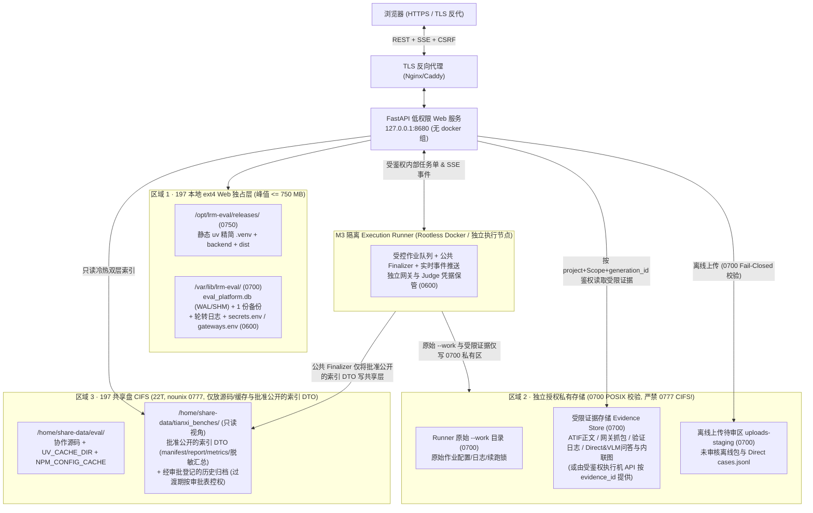

# 06-1 · 系统架构、三区存储与受限证据隔离、授权映射与 197 部署拓扑

本文档收敛系统架构、**公开索引层 vs 受限证据存储层边界（解决现存 `0666`/`0777` CIFS 源文件泄露隐患）**、`resource → project/owner` 完整查询授权映射（含撤权后快照重开校验），以及 197 实机部署契约（本地 Web 运行盘统一上限 **750 MB**）。

---

## 1. 技术栈与三区隔离部署架构

- **前端**：React 19 + TypeScript 5 + Vite 6 + Ant Design 5 + Tailwind CSS v4 + **Motion (`LazyMotion` + `domAnimation`, < 18 KB gzip)** + Apache ECharts 5（含 `universalTransition`）+ TanStack Table v8 + TanStack Virtual + TanStack Query v5 + Zustand + `react-markdown` + Shiki。
- **后端**：Python 3.12 + FastAPI + Uvicorn + Pydantic v2 + SQLite（本地 ext4 独占 WAL + FTS5，Repository 抽象预留 PostgreSQL 切换）+ SSE 推送。

---

## 2. 安全、认证、通用脱敏与完整授权映射契约（M0/M1 开放门槛）

### 2.1 传输安全、Cookie、初始化与通用路径脱敏
- **HTTPS 与 Cookie**：生产入口经 TLS 反代走 HTTPS，Cookie 默认 `HttpOnly; Secure; SameSite=Lax`，保留显式环境变量 `COOKIE_SECURE=true`（仅在 M0/M1 临时 HTTP 内网演示显式设为 `false`）。
- **CSRF 与初始 Admin**：所有写接口校验 `Origin`/`Referer` + Double-Submit CSRF Token；Admin 密码通过 CLI/环境变量以 `argon2id` 初始化，代码库零硬编码弱口令。
- **通用路径脱敏**：对所有 `source.path`、`raw_log.path`、`verifier-output.txt` 与 SSE 日志中的绝对路径（覆盖 `/home/*` 与跨机 `/tmp/*`）统一掩码前缀，仅暴露 `<redacted>/.../相对尾段`；内部回填指纹 `internal_source_fingerprint` 严禁进入任何 API 响应。

### 2.2 Resource → Project / Owner、先授权再去重顺序与查询授权映射
1. **资源归属登记**：每条 `batches`、`saved_comparisons`、`sample_sets`、`exec_jobs`、`direct_lab_runs`、`param_compare_groups`、`offline_reports` 均强制绑定 `(project_id, owner_id)`，并严格区分**团队项目（`project_id` 非 `personal:*`）**与**个人项目（`project_id = "personal:" + owner_id`）**；每条批次同时记录 `evidence_approval`。
2. **统一鉴权裁决函数 `authorize(user, resource, action, required_scope)`**：
   - **严格项目成员资格校验（禁止 `owner_id` 绕过团队撤权）**：
     - 若资源归属**团队项目**（非 `personal:*`）：仅当 `user.role == "admin"` **或** `resource.project_id in user.active_projects` 时放行——**即使 `resource.owner_id == user.user_id`，一旦用户被移出该项目，访问仍立即返回 `403 PROJECT_FORBIDDEN`**！
     - 若资源归属**个人项目**（`project_id == "personal:" + resource.owner_id`）：仅允许 `resource.owner_id == user.user_id`（或 `admin`）访问。
   - **先授权裁剪、再按协议去重（杜绝跨项目泄露与全局赢家遮蔽）**：所有榜单汇总、全文检索与动态对比查询**必须先按当前用户的授权项目集 + 选定数据源缩小候选集，再在授权子集内按 `(canonical_trial_key, scoring_protocol)` 去重**——确保同 UUID 分属无权项目 A 与有权项目 B 时，既不泄露项目 A，也不让项目 A 压掉用户在项目 B 下的合法副本！
   - **6 项明细 Scope 校验**：`trace:read`、`gateway:read`、`verifier_log:read`、`dataset:answer_read`、`dataset:holdout_read`、**`direct_vlm_qa:read`**（显式覆盖 Direct / VLMEvalKit 问答正文与内联多模态图像）。
   - **全出口零旁路（含下载、导出与撤权后快照重开）**：

| 权限维度 | 详情 API | 全局 `⌘K` 搜索 | 媒体流 `/media` 与 `.../media/{idx}` | 产物下载 `/artifacts` | 报告导出 (`CSV/HTML/PDF`) | 冻结快照重开 `/compare/s/:id` |
|---|---|---|---|---|---|---|
| **项目边界 (`project_id`)** | 无权返回 `403` | `search_fts` 按 `project_id` 过滤 | 拦截返回 `403` | 拦截返回 `403` | 拦截返回 `403` | **每次打开按当前浏览者实时重验**；撤权后立即拒绝访问 |
| `trace:read` | 无权仅返步骤数与工具计数 | 不索引/不返正文 | — | 拦截轨迹下载 | 省略轨迹列 | 撤权后打开旧快照动态剥离受限轨迹引用 |
| `gateway:read` | 默认脱敏摘要；有权返二级清洗正文 | 不索引网关正文 | — | 拦截原始抓包 | 默认仅导摘要 | 撤权后退回脱敏摘要 |
| `verifier_log:read` | 无权仅返子分与固定 `failure.summary` | 不搜日志文本 | — | 拦截日志下载 | 省略日志列 | 撤权后仅保留结构化评分 |
| `dataset:answer_read` | 默认隐藏标准答案/参考解/测试脚本 | 不返答案字段 | — | 拦截 `solution/`/`tests/` | 省略标准答案列 | 撤权后隐藏答案列 |
| `dataset:holdout_read` | 无权仅见聚合指标，不返留出题面 | 过滤留出题正文 | 拦截留出题历史与内联图 | 拦截留出题产物 | 仅导汇总指标 | 撤权后隐藏留出题正文与样例 |
| `direct_vlm_qa:read` | 无权仅见评分、状态、`http_status` 与耗时，不返问答正文 | 不索引问答正文 | **拦截 `vlmeval_result` 内联 base64 图与受限原图** | 拦截 `predictions`/明细下载 | 仅导汇总指标与状态 | 撤权后重开快照不暴露问答正文与内联图 |

---

## 3. 共享层 vs 受限证据存储边界与历史共享盘过渡审批（修复 `0666` CIFS 源文件风险）

> **实测风险闭环（落实 `@theshy` 审校意见）**：经 197 实测，现有 CMMMU `vlmeval_result.request_messages` 内联图像、历史 ATIF 与网关抓包均已以 `mode 0666` 落在 `/home/share-data`（`nounix 0777` CIFS）上。**仅靠 Web API 鉴权无法阻止宿主机其他普通账号直接读 CIFS 源文件！**

因此明确**目标存储架构**与**现存共享数据过渡审批方案**：
1. **目标态硬边界（所有经平台 Runner / 新版公共 Finalizer 产出的新批次）**：
   - **共享 CIFS 层（`/home/share-data/tianxi_benches/harbor-runs/`）**：**只接收批准公开的索引 DTO**（`manifest.json`、脱敏 `batch-status.json`、`batch-report.json`、`official-result.json`、`vlmevalkit/metrics.json`、`run-config.json`、`publish-manifest.json` 与不含受限正文的轻量化 `episodes.jsonl` 摘要行）；
   - **独立授权证据存储（`0700` POSIX 隔离存储或受鉴权执行机 Evidence API）**：存放所有受限正文、内联与原始多模态图像、ATIF 轨迹、网关原始抓包、验证器原始日志、Direct/VLMEvalKit 原始问答，以及 Runner 原始 `--work` 与离线待审上传区；Web 后端校验用户 `project_id + Scope + generation_id` 后按不透明 `evidence_id` 代理流式提供！
   - **Fail-Closed 权限探针**：Web 与 Runner 启动及写入隔离工作区/证据区/待审区前强制检测 `chmod 0700` 实际生效（`stat.mode & 0o077 == 0` 且文件系统非 `cifs`/`vfat`），一旦误指 `0777` 共享盘立即阻断返回 `503 STAGING_PERMISSION_UNSAFE`。
2. **现存共享数据的来源审批登记与过渡降级策略**：
   - 维护显式审批清册 **`config/source_approval_registry.yaml`**，逐目录登记现存 `/home/share-data/tianxi_benches/` 与 `/home/share-data/dataset/` 的 `(source_root, project_id, owner, approved_evidence_classes, approval_status)`；
   - **过渡期安全默认**：对清册中**尚未获批**的受限证据目录，Web 平台自动降级（保留批次/试验状态、得分与分母，隐藏未批正文与内联图并标明「来源待审批」）；
   - **历史共享盘盘点与迁移审批**：现有 `0666` CIFS 上的旧 ATIF、旧网关抓包与旧 `vlmevalkit` 内联图是否迁移至独立 `0700` 证据存储或清理旧副本，**必须经资产负责人（`@caozs2` 及相关执行机属主）明确盘点审批后执行，平台本身只读不擅自删除共享盘历史文件**。
3. **Web 账号零 `docker` 组 & 凭据 `0600` 独占**：Web 服务账号严禁入 `docker` 组；`gateways.env` / `secrets.env` 仅落本地 ext4 `0600`。

---

## 4. 197 实机部署拓扑与统一 750 MB 本地盘预算（M0 部署契约）

### 4.1 197 实测环境硬约束（含 2026-11-24 最新磁盘水位）
- `/home/share-data`：**CIFS**（22T，`nounix, file_mode=0666, dir_mode=0777`）；`/data`：**只读 `ro` NFSv4**（17T）；
- `/`（本地 ext4）：98G 总容量，**最新实测仅余 1.7 GB（使用率已达 99%！逼近 1.5 GB 保护线）**，亟需运维清理/扩容或优先采用独立 PostgreSQL 实例；
- 系统 Python 3.12 无 `ensurepip`，采用静态 `uv` 引导本地 `.venv`；
- **前端构建提速优化（197 实测 `/dev/shm` 有 252 GB tmpfs，整机内存 503 GB）**：将 `NPM_CONFIG_CACHE` 与源码留 `/home/share-data/eval/`（CIFS），但避免直接在 CIFS 上解压数万 `node_modules` 小文件导致 `npm ci` 耗时长达 5–10 分钟——`build-frontend.sh` 在临时内存盘目录（如 `/dev/shm/lrm-eval-fe-build`，`0700`）执行扁平 `npm ci && npm run build`，将编译出的纯静态 `dist/`（~25 MB）拷贝到 `/opt/lrm-eval/releases/<ver>/dist/` 后**立即清理 `/dev/shm` 临时目录**，构建提速 10 倍且对 197 本地 `/` 零永久占用！

### 4.2 统一本地 ext4 Web 运行盘预算（硬上限 **750 MB**，含双版本升级、WAL/SHM 与备份）

| 本地目录与项目 | 权限 | 预算上限 | 控容与运维策略 |
|---|---|---|---|
| `/opt/lrm-eval/releases/<v_curr>`（精简 `.venv` ~150 MB + 后端 + `dist` ~25 MB） | `0750` | **175 MB** | 仅含运行期最小依赖 |
| `/opt/lrm-eval/releases/<v_prev>`（蓝绿升级保留 1 个旧版回滚） | `0750` | **175 MB** | 最多保留 1 个历史版 |
| `/var/lib/lrm-eval/eval_platform.db` + `-wal` + `-shm` | `0700` | **185 MB** | 仅存元数据与字节偏移（DB ≤ 150 MB，WAL ≤ 32 MB，SHM ~1 MB） |
| `/var/lib/lrm-eval/backups/`（最新 1 份 `.db.zst` 备份） | `0700` | **45 MB** | 本地仅留 1 份最新备份 |
| `/var/lib/lrm-eval/logs/`（滚动日志 `10 × 15 MB`） | `0700` | **150 MB** | `RotatingFileHandler` 硬上限 |
| `/var/lib/lrm-eval/{secrets.env, gateways.env}` | `0600` | **< 1 MB** | 仅服务账号可读 |
| **本地峰值合计（含蓝绿升级瞬间 + WAL/SHM + 备份）** | — | **≤ 731 MB（统一红线 750 MB）** | 发布前校验 `/` 剩余 **≥ 1.5 GB**；本地占用达 600 MB 或 `/` 剩余 < 1.5 GB 红色告警（鉴于 `/` 已达 97%，建议尽早确认扩容或切换独立 PostgreSQL） |
