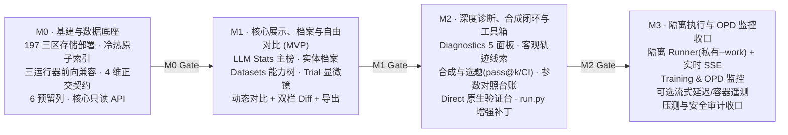

# 07-1 · 分期里程碑、阶段准出门槛（Gate）与协同分工

---

## 1. 四阶段里程碑与严格开放门槛（M0–M3）

| 阶段 | 核心交付模块 | 必须通过的开放/准出门槛（Gate） |
|---|---|---|
| **M0 · 基建与数据底座** | `/home/share-data/eval` 源码初始化 + 静态 `uv` / 扁平 `npm` 构建脚本；197 本地 ext4 独占状态层与隔离待审存储权限探针；认证/CSRF/6 项明细 Scope 框架；SQLite 完整 DDL（含双层数据身份/`batch_id`/先授权再去重 `trial_protocol_scores`/`offline_reports`/`goal_type`/运行中占位/6 预留列）；冷热双层异步索引器（兼容 `harbor`/`direct`/`vlmevalkit` + 剥离内联 base64 + `.publish.lock` 不阻塞 + 摘要防混合版本 + 跨来源去重 + 版本化媒体匹配规则）；核心只读 API | ① 197 存储/数据库及隔离私有存储方案落定； ② 正交 4 维口径 + 原生 `reward_valid` 230 条保留（`A-13`）+ 共同有分 Macro Avg + 三运行器 + 原子快照去重单测全绿并经 `@theshy` 签字； ③ 热层全量首扫 < 5s、15s 增量 < 200ms，冷层异步缓存命中即跳过 |
| **M1 · 核心展示、效率轨迹图与自由对比 (MVP)** | Home（含 **Gain vs Guardrail 三线结论卡** 与流光展示动效）+ **LLM Stats 高密主榜全套控件**（赛道页签/Harbor 真实筛选/`Columns`/`Copy link`/`Compare`/同上下文 4 视图切换/最高分高亮）+ **ARC Prize 式效率前沿与同族轨迹图** + Model/Harness/Benchmark 独立档案 + Datasets 零代码扩展三线能力树 & Task 浏览器 + Report 与 Trial 显微镜（三运行器全兼容）+ Dynamic Comparison 与双栏 Diff/导出 + **全站产品级动效体系（60fps + 骨架屏 + `prefers-reduced-motion`）** + 基础版 `/admin/health` | ① HTTPS/`COOKIE_SECURE`/CSRF + 通用路径脱敏 + 6 项明细 Scope 零旁路验收通过； ② 三线完整验证路径（`A-14`）、TB2.1 六组 71 题效率前沿图（`A-15`）、DeepSWE(48/39)、GAIA(165/118)、单列缺基准 Macro Avg、`vlmevalkit` 三态、版本化媒体降级与动效流畅度（`E-03`：`CLS < 0.05` / `INP < 100ms`）全部 E2E 通过； ③ `@caozs2` 在 197 浏览器实测确认视觉、动效质感、流畅度与数据真实性 |
| **M2 · 深度诊断、合成闭环与工具箱** | Diagnostics（5 步研究员流 / 14 类故障聚类 / WildClaw 17 子分与 `vlmevalkit` 学科热图 / 耗时与 Token 帕累托 / 包含语义校验 / Tool Call 画像 / 4 项客观轨迹线索与覆盖分母）+ Synthetic Studio & RL/SFT 选题（`pass@1..k` / `pass^k` / 95% 置信区间）+ Model Recommender + Toolkit（Offline Verify 3 Tab / Harbor-Direct-VLMEvalKit 参数对照台账 / Manuals 含 `VLMEVALKIT.md` & 独立 Methodology 页）+ Direct 原生验证工作台（`cases.jsonl` + 白名单评分器）+ 完整 `/admin/health` + 上游 `run.py:publish()` 增强补丁 | ① `round1` (40×8) 选题与 `pass@8` 缺测分母（19/40）验收通过； ② **Direct 验证工作台网关凭据隔离、白名单评分器零任意执行、CSRF 与隔离待审存储权限（`S-06`）通过 `@theshy` 安全审查**； ③ `run.py:publish()` 补丁跑通单题验证 `publish-manifest.json`、4 阶段耗时与 128 KiB 脱敏截断验证日志 |
| **M3 · 隔离执行与 OPD 监控收口** | **隔离 Execution Runner**（Rootless Docker 或独立执行节点，原始 `--work` 落隔离 `0700` 私有存储彻底脱离 `0777` CIFS）+ Benchmark Execution 实时事件流（SSE + `Last-Event-ID` 断线补读 + 最终快照对账 + 完工/熔断通知 + 原生 Harbor / 任务级续跑）+ Training & OPD 监控（空态引导 + 隔离契约夹具单测 + 真实首跑验证指南）+ 可选网关流式 TTFT/TPS 与容器 cgroup 遥测 + 全站性能压测与安全审计 | ① **隔离 Runner 方案评审通过：Web 账号零 `docker` 组 + 另一普通 Linux 账号实测无法读取原始 `--work` 与待审上传，同时授权用户在站内可见批准细节（`S-06`）**； ② 实时事件断线补读与最终快照对账 E2E 通过（`I-05`）； ③ 压测 5,000+ episodes 且 197 本地盘峰值 ≤ **750 MB**（含双版本升级、WAL/SHM 与备份）零高危漏洞 |

---

## 2. 团队协同分工与评审闭环

| 成员 | 角色 | 核心职责 |
|---|---|---|
| **`@caozs2`** | 项目负责人 | 拍板本开发设计文档定稿、确认 197 本地目录/HTTPS 与 M3 隔离执行节点方向、各里程碑产品验收 |
| **`@chovy`** | 开发文档规划 | 维护本树形开发设计文档与 `METHODOLOGY_REGISTRY` 口径及双向数据来源表；随评审持续迭代；各里程碑核对需求与数据真实性并交付最终用户手册 |
| **`@369`** | 全栈开发 | 在 `/home/share-data/eval/` 承接后端（FastAPI + 冷热索引器 + API + Runner）与前端（React 19 + ECharts 5）编码、构建脚本、pytest/Playwright 自动化测试与 197 发布部署 |
| **`@theshy`** | 代码审核 | 按各阶段 Gate 逐项审校 PR 与实机数据：严守 Harbor 数据边界、正交口径/交集分母/去重/原子快照、Token 包含语义校验、6 项明细 Scope 零旁路、本地盘限额与 Runner 私有存储隔离安全 |
